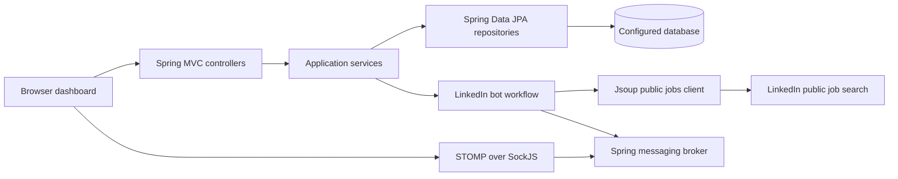
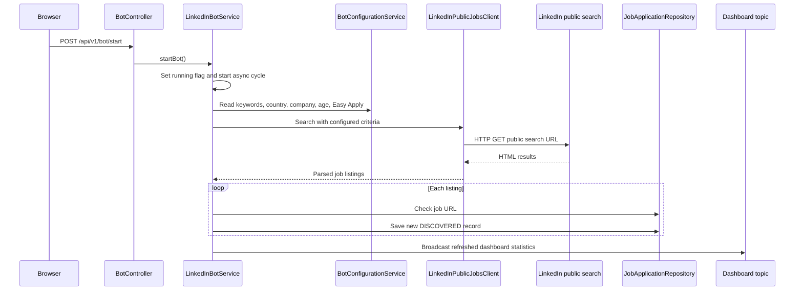
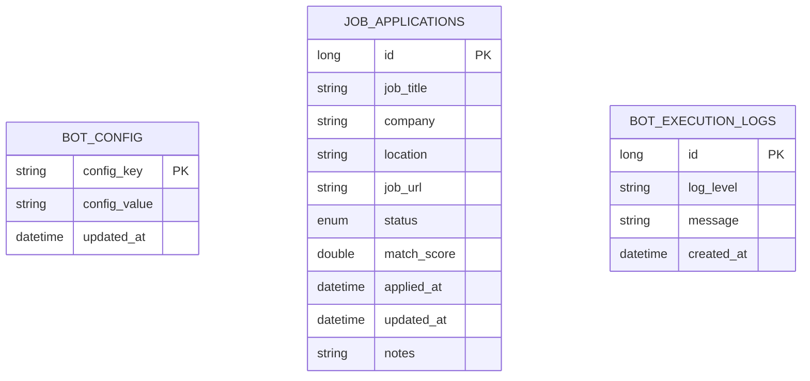

# Technical Documentation

## 1. Purpose and Scope

The LinkedIn Job Application Bot is a Spring Boot web application that searches LinkedIn's public job-search pages, stores discovered jobs, exposes REST APIs for job tracking and bot control, and presents a live dashboard.

The current implementation discovers jobs and records them for manual review. It does not log in to LinkedIn or submit applications automatically.

## 2. Technology Stack

| Area | Technology |
| --- | --- |
| Language and runtime | Java 21 |
| Build | Apache Maven |
| Application framework | Spring Boot 3.4.3 |
| HTTP and REST | Spring Web MVC |
| Server-rendered UI | Thymeleaf and Bootstrap 5.3.3 |
| Browser icons | Font Awesome 6.5.1 |
| Real-time updates | Spring WebSocket with STOMP and SockJS |
| Persistence | Spring Data JPA and Hibernate 6 |
| HTML retrieval and parsing | Jsoup 1.18.3 |
| Validation | Spring Boot validation / Jakarta Bean Validation |
| API documentation | Springdoc OpenAPI 2.8.5 |
| Databases | H2, PostgreSQL, Oracle, and Microsoft SQL Server |
| Tests | JUnit 5, Spring Boot Test, Mockito, AssertJ |
| Boilerplate reduction | Lombok |

The dependency and plugin definitions are in [pom.xml](../pom.xml).

## 3. Runtime Architecture



The application starts in `LinkedInJobBotApplication`, which enables scheduling and asynchronous execution. The main package is `com.cth.sdm` and is organized into controllers, services, workflow components, repositories, entities, DTOs, and configuration.

## 4. Request and Processing Flows

### 4.1 Dashboard request

1. The browser requests `GET /`.
2. `DashboardViewController` asks `DashboardService` for aggregate metrics and all stored applications ordered by application date descending.
3. The controller renders `templates/index.html` with Thymeleaf.
4. The browser creates a SockJS connection to `/ws-dashboard` and subscribes to `/topic/dashboard-updates`.
5. Bot events cause the service to publish refreshed dashboard statistics; the page updates its counters and table without a full page reload.

### 4.2 Bot discovery cycle



A scheduled cycle runs at the configured fixed delay while the bot is running. The default interval is 60,000 ms and the default maximum result count per cycle is 10. A single cycle can also be triggered while the bot is stopped.

Only one asynchronous cycle runs at a time. A second trigger exits when the current cycle is already running. Stopping the bot changes the in-memory running flag; it does not interrupt a cycle that has already started.

### 4.3 LinkedIn search

`LinkedInPublicJobsClient` constructs a public search URL using keywords, country, posting age, optional company, and optional Easy Apply filtering. Jsoup downloads and parses the result page. The client extracts title, company, location, URL, and a calculated match score from each result.

The scraper relies on LinkedIn's public HTML structure and selectors. It does not use an authenticated LinkedIn API.

## 5. Persistence Model



### Tables and entities

- `job_applications`, represented by `JobApplication`, stores discovered and manually recorded jobs. The status values are `DISCOVERED`, `APPLIED`, `INTERVIEW_SCHEDULED`, `REJECTED`, `OFFER_RECEIVED`, and `FAILED`.
- `bot_config`, represented by `BotConfig`, stores configuration as string key/value pairs.
- `bot_execution_logs`, represented by `BotExecutionLog`, stores informational and error messages from bot execution.

Repositories are in `src/main/java/com/cth/sdm/repository`. Entity mappings are in `src/main/java/com/cth/sdm/model/entity`.

Duplicate discovery is prevented by checking `job_url` in application code before saving. There is currently no database unique constraint on that column.

## 6. REST API

### Bot control: `/api/v1/bot`

| Method | Path | Behavior |
| --- | --- | --- |
| GET | `/status` | Returns running state, status message, processed count, and current keywords |
| POST | `/start` | Starts scheduled discovery and triggers an initial asynchronous cycle |
| POST | `/stop` | Stops future scheduled cycles |
| POST | `/trigger-cycle` | Starts one asynchronous discovery cycle |

### Configuration: `/api/v1/config`

| Method | Path | Behavior |
| --- | --- | --- |
| GET | `/` | Returns current age, country, company, Easy Apply flag, and keywords |
| PUT | `/` | Validates and saves configuration |

Validation accepts a job age from 1 through 365 days, a country, optional company up to 150 characters, and search keywords up to 500 characters. The dashboard presents country as a dropdown.

### Jobs: `/api/v1/jobs`

| Method | Path | Behavior |
| --- | --- | --- |
| GET | `/` | Returns stored jobs ordered newest first, currently capped at 100 records by the controller |
| GET | `/paged` | Returns a Spring `Page` using `page` and `size` query parameters |
| GET | `/{id}` | Returns one job or HTTP 404 |
| POST | `/` | Manually creates a job record and returns HTTP 201 |
| DELETE | `/{id}` | Deletes a job or returns HTTP 404 |

### Reporting: `/api/v1/reports`

`GET /export/csv` generates a CSV containing all job application records and returns it as a downloadable file.

### API documentation

OpenAPI JSON is available at `/v3/api-docs`; Swagger UI is available at `/swagger-ui.html`.

## 7. Configuration and Profiles

The default profile is `h2` and the default server port is `8080`. Main settings are in [application.yml](../src/main/resources/application.yml):

- `bot.auto-apply-interval-ms`: scheduled cycle delay; default `60000`.
- `bot.default-target-location`: fallback target location; default `Remote`.
- `bot.max-results-per-cycle`: maximum listings requested per cycle; default `10`.
- `bot.linkedin.request-timeout-ms`: Jsoup request timeout; default `10000`.

Database-specific settings are supplied by:

- [application-h2.yml](../src/main/resources/application-h2.yml)
- [application-postgres.yml](../src/main/resources/application-postgres.yml)
- [application-oracle.yml](../src/main/resources/application-oracle.yml)
- [application-sqlserver.yml](../src/main/resources/application-sqlserver.yml)

Schema scripts are in `scripts/db`. H2 is configured as an in-memory database, so its data is not durable across restarts.

## 8. Build, Run, and Test

```text
mvn clean package
mvn test
```

Windows helper scripts are `build.bat`, `start.bat`, and `stop.bat`. Unix-like equivalents are `start.sh` and `stop.sh`.

The application is normally available at `http://localhost:8080` after startup.

## 9. Security and Operational Considerations

- Authentication and authorization are not configured in the current application. Bot control, configuration, deletion, and CSV export endpoints should be protected before production exposure.
- Bot state is held in process memory and is not shared across application instances.
- The LinkedIn scraper depends on undocumented public page markup and may be affected by rate limiting or site changes.
- Dashboard refreshes currently load all stored applications into memory. Large datasets should use server-side pagination or bounded queries.
- A database uniqueness constraint on `job_url` would make duplicate prevention reliable under concurrent execution.
- The application stores a manual-review note; it does not submit applications to LinkedIn.

## 10. Source Map

- Bootstrap: [LinkedInJobBotApplication.java](../src/main/java/com/cth/sdm/LinkedInJobBotApplication.java)
- Views: [DashboardViewController.java](../src/main/java/com/cth/sdm/controller/DashboardViewController.java), [index.html](../src/main/resources/templates/index.html), [config.html](../src/main/resources/templates/config.html)
- Bot workflow: [LinkedInBotService.java](../src/main/java/com/cth/sdm/workflow/LinkedInBotService.java), [LinkedInPublicJobsClient.java](../src/main/java/com/cth/sdm/workflow/LinkedInPublicJobsClient.java)
- Dashboard aggregation: [DashboardService.java](../src/main/java/com/cth/sdm/service/DashboardService.java)
- WebSocket setup: [WebSocketConfig.java](../src/main/java/com/cth/sdm/config/WebSocketConfig.java)
